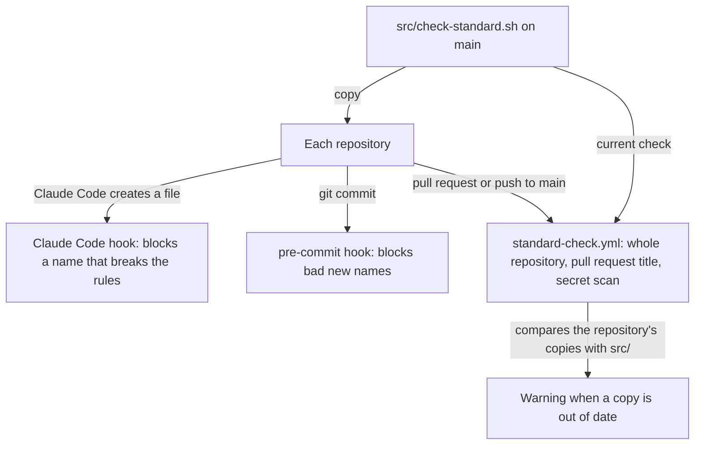

# BuildexLabsAI/.github

The BuildexLabsAI organization's default community files, its repository standard, and the
check that enforces the standard in every repository.

## What it does

- GitHub shows [CONTRIBUTING.md](CONTRIBUTING.md), [SECURITY.md](SECURITY.md) and the
  [pull request template](.github/pull_request_template.md) in every BuildexLabsAI repository
  that has none of its own. GitHub reads these defaults only from a public `.github` repository,
  so this one is public and holds nothing secret.
- [CONTRIBUTING.md](CONTRIBUTING.md) is the full standard. [src/agents-block.md](src/agents-block.md)
  is the short version that every repository's AGENTS.md carries for AI agents.
- [src/check-standard.sh](src/check-standard.sh) enforces the standard in three places. The
  Claude Code hook and the git pre-commit hook run each repository's copy at
  `.github/scripts/check-standard.sh`. CI runs the current check from this repository's main:



## What it doesn't do

- Does not block a merge on GitHub Free. CI shows a red X and merging still works.
  [docs/enforcement.md](docs/enforcement.md) says how to switch on hard enforcement with GitHub
  Team.
- Does not update the copies in other repositories. A rule merged here applies in every
  repository's CI at once, while the hooks keep running the old copy until someone replaces it.
- Does not fix files. The check reports problems and changes nothing.

## Run it locally

```bash
git clone https://github.com/BuildexLabsAI/.github.git
cd .github
bash tests/check-standard.test.sh
bash .github/scripts/check-standard.sh
```

The tests build throwaway repositories and run the check against them. In this repository
`.github/scripts/check-standard.sh` is a link to `src/check-standard.sh`, so the hooks run the
file every other repository copies.

CI runs the check with `--canonical`, which also compares this repository's AGENTS.md block with
`src/agents-block.md`, and lints the scripts with ShellCheck:

```bash
bash src/check-standard.sh --canonical src
```

The tests and the Claude Code hook need `jq`. Without it, the hook skips the file-name check and says so.

## Changing the standard

1. Open a pull request here. Change the rule in `src/check-standard.sh` and add a test to
   `tests/check-standard.test.sh` that fails without the change. If agents need to know the rule,
   update `src/agents-block.md`, the block in this repository's AGENTS.md and CONTRIBUTING.md in
   the same pull request.
2. After the merge, update BuildexLabsAI/repo-template first, so new repositories start current.
   With both repositories cloned side by side, run this from this one:

   ```bash
   cp src/check-standard.sh ../repo-template/.github/scripts/check-standard.sh
   awk 'NR == FNR { block = block $0 "\n"; next }
        /buildexlabs-standard:start/ { printf "%s", block; skip = 1 }
        !skip { print }
        /buildexlabs-standard:end/ { skip = 0 }' src/agents-block.md ../repo-template/AGENTS.md > AGENTS.md.new
   mv AGENTS.md.new ../repo-template/AGENTS.md
   ```

3. Check the copies from repo-template. The run must end with 0 warnings:

   ```bash
   cd ../repo-template
   bash .github/scripts/check-standard.sh --canonical ../.github/src
   ```

A new rule applies in every repository's CI as soon as it is merged. CI also warns in each
repository until someone updates its copies the same way.

## Project structure

```
CONTRIBUTING.md            the full standard; GitHub shows it in every repository without its own
SECURITY.md                how to report a security problem; shown the same way
src/check-standard.sh      the canonical check
src/agents-block.md        the rules block every repository's AGENTS.md copies
tests/                     tests for the check
.github/workflows/         standard-check.yml, the shared CI workflow; standard.yml, this repository's CI
.github/hooks/pre-commit   runs the check on the files you commit
docs/                      what is enforced where, and the ruleset to switch on with GitHub Team
```

New repositories start from [BuildexLabsAI/repo-template](https://github.com/BuildexLabsAI/repo-template).

## Deploy

Not deployed to a server. Merging to main is the release: GitHub shows the new default files at
once, and every repository's CI runs `standard-check.yml` and the check from this repository's
main branch.

## Media and large files

None.

## First-time setup

Once per clone, switch on the check that runs before every commit:

```bash
git config core.hooksPath .github/hooks
```

## Owner

@eskokoivula
